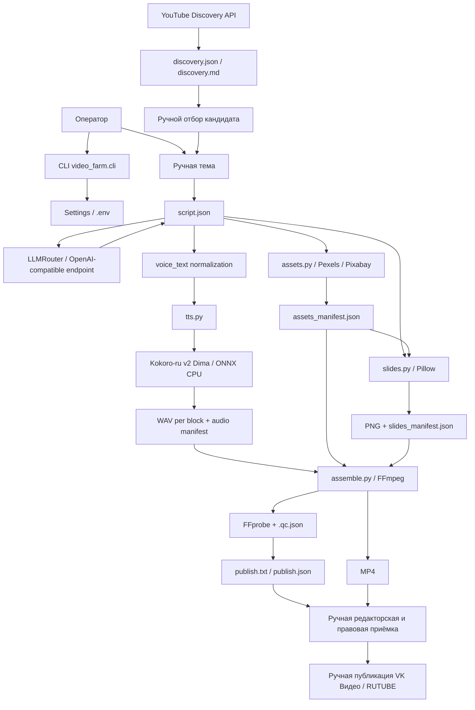

# AI Video Factory RU / video-farm — актуальная архитектура

- **Версия:** 2.0
- **Дата актуализации:** 06.11.2026
- **Базовый кодовый коммит:** `4f7e3df` — `Integrate Kokoro TTS into production pipeline`
- **Последний коммит документации на момент актуализации:** `74ffdb2` — `Align current Kokoro test status in documentation`
**Статус:** текущая архитектура локального CLI зафиксирована. Короткий технический E2E принят; полноценный производственный E2E и готовность к регулярному выпуску роликов ещё не подтверждены.

> Этот документ описывает актуальную ветку `video-farm` в репозитории `AI_Video_Factory_RU`. Старые материалы о Piper, прежнем Streamlit-прототипе и экспериментальных архитектурных вариантах не являются описанием текущего production path. Исторические результаты сохраняются в соответствующих документах и не переписываются задним числом.

## 1. Назначение системы

AI Video Factory RU — локальная фабрика подготовки оригинальных русскоязычных видео. Она автоматизирует повторяемые технические операции, но оставляет оператору редакторские, фактологические, лицензионные и публикационные решения.

Основной рабочий процесс:

**исследование темы → выбор темы → структурированный сценарий → нормализация текста для речи → Kokoro TTS → поиск и загрузка визуальных материалов → PNG-слайды → монтаж MP4 → FFprobe/QC → пакет публикации → ручная приёмка → ручная публикация.**

Целевые площадки публикации — VK Видео и RUTUBE. YouTube используется как источник исследовательских данных, а не как целевая площадка публикации в текущем MVP.

Цель MVP — обеспечить воспроизводимый цикл создания видео с корректной озвучкой, проверяемыми источниками, учётом фактически использованных визуальных материалов и понятными критериями ручной приёмки. Система не гарантирует просмотры, рост аудитории, одобрение монетизации или доход.

## 2. Область действия и эксплуатационная модель

- Тип продукта: локальное CLI-приложение, не SaaS и не обязательная веб-панель.
- Целевая ОС: Windows 10/11 x64.
- Рабочая версия Python: 3.12 или 3.13 x64; на целевой машине зафиксирован Python 3.13.14.
- Целевая машина проекта: Intel Core i5-11400, 32 GB RAM, без дискретной видеокарты.
- Медиасборка: FFmpeg и FFprobe, доступные через `PATH`.
- Оператор: один владелец проекта. Он выбирает тему, проверяет сценарий, прослушивает речь, смотрит готовое видео и разрешает публикацию.
- Конфигурация и секреты: `.env` в корне проекта; файл `.env` не коммитится.
- Внешние API вызываются только при наличии настроенных ключей и работающего доступа. Отсутствующие ключи не имитируются и не заменяются фиктивными результатами.

Отдельный Streamlit-прототип не считается частью этой CLI-архитектуры. Код, UI и SQLite-ограничения бюджета из другого прототипа нельзя считать реализованными в `video-farm`, пока они не перенесены в эту ветку и не прошли отдельные тесты.

## 3. Архитектура верхнего уровня

Схема показывает логические зависимости. Текущая команда `run` выполняет шаги последовательно: сценарий (или готовый JSON) → TTS → поиск/загрузка медиа → слайды → MP4/QC → описание публикации. Это не параллельная очередь задач.

Исследование Discovery выполняется отдельной командой до `run`. Оно не запускается автоматически внутри полного производственного `run`.

## 4. Производственные этапы и границы автоматизации

### 4.1. Исследование темы

Текущий модуль Discovery использует YouTube Data API для получения кандидатов и формирует:

- `output/discovery/discovery.json`;
- `output/discovery/discovery.md`.

Далее оператор выбирает кандидата. `discover-editor` создаёт локальную HTML-страницу для ручного отбора; страница не вызывает YouTube API. `discover-quota` помогает сверять локальный учёт вызовов `search.list`, а `discover-cleanup` удаляет просроченный Discovery-отчёт по правилам проекта.

Старая команда `analyze` отключена: она рассчитывала производные аналитические метрики, для которых требуется отдельное разрешение/проверка условий YouTube API. `topics` — legacy-команда шаблонной генерации тем; она не является автоматическим ранжировщиком Discovery-кандидатов.

Discovery не доказывает, что тема вирусная или что просмотры будут расти. Значение `viewCount` — общее число просмотров, а не скорость их прироста.

### 4.2. Сценарий и LLM

Команда `script` создаёт структурированный JSON-сценарий. LLM вызывается через настроенный OpenAI-compatible endpoint; конфигурация провайдеров хранится в `Settings`, загружаемых из `.env`.

Сценарий содержит смысловые блоки, экранный текст и поля, используемые для озвучки и визуального оформления. В нём также могут присутствовать `fact_checks` и `quality_warnings`, но их наличие не означает, что утверждения автоматически проверены внешними источниками.

Обязательное разделение:

- `text` — редакторский/экранный текст;
- `voice_text` — текст для синтеза речи.

Оператор должен проверить факты, ссылки, имена, числа, даты, термины, структуру, длительность и качество повествования до запуска полного конвейера. LLM не является источником истины и не заменяет фактчекинг.

### 4.3. Нормализация и озвучка

Production TTS path:

- движок: `zaakirio/kokoro-ru`, revision `d649c57`;
- голос: `dima`;
- backend: ONNX Runtime `CPUExecutionProvider`;
- синтез выполняется локально на CPU;
- production entry point: `src/video_farm/tts.py`;
- движок: `src/video_farm/kokoro_engine.py`;
- правила ударений: `src/video_farm/kokoro_stress.py` и `data/kokoro_stress_config.json`.

Нормализация применяется к `voice_text`, а не к экранному `text`. Ограниченно поддержанные числовые конструкции преобразуются в произносимые формы. Неоднозначные или неподдержанные элементы отражаются в `unconverted_numeric_tokens` и требуют ручной проверки.

Каждый блок сценария получает отдельный WAV и запись в `audio/manifest.json`. Для текущего production-контракта ожидается PCM16, mono, 24 000 Hz. Manifest фиксирует статус и сведения, позволяющие связать аудио с исходным блоком и проверить происхождение результата.

Состояния не следует смешивать:

- `complete` — ожидаемые блоки синтезированы;
- `failed` — синтез не завершён; ошибка должна быть видимой.

Piper не является текущим production движком и не используется как автоматический fallback. При проблеме Kokoro система должна сообщить об ошибке, а не подменить голос или движок незаметно.

Расположение и подготовка ресурсов:

- snapshot модели Kokoro: `data/models/kokoro-ru-v2-onnx/`;
- локальные данные RUAccent: `data/models/ruaccent-accentuator/`;
- пользовательские правила: `data/kokoro_stress_config.json`.

Эти наборы не взаимозаменяемы. Наличие JSON-конфигурации ударений не заменяет каталоги словарей и нейросетевых ресурсов RUAccent. `doctor` проверяет подготовку необходимых RUAccent каталогов. Первый запуск может потребовать интернет для загрузки закреплённого snapshot Kokoro; автоматическая загрузка RUAccent в production helper не заявлена.

Модельные веса, голосовые файлы, полный датасет и локальные кэши не добавляются в публичный GitHub.

### 4.4. Поиск и учёт визуальных материалов

`src/video_farm/assets.py` обращается к Pexels и/или Pixabay, если в `.env` заданы соответствующие API-ключи. Результат записывается в `assets_manifest.json`; в нём сохраняются доступные сведения о файле, источнике, исходной странице, авторе и поисковом запросе.

Если ключей нет, модуль формирует manifest с пустыми списками и предупреждением: это не означает, что реальные стоки были получены. Такой запуск может быть полезен для технической проверки сборки, но не закрывает требование полного E2E с реальными лицензируемыми визуалами.

Важно различать:

- `assets_manifest.json` — найденные/скачанные кандидаты;
- `used_media` в QC-отчёте — материалы, которые фактически попали в собранный timeline.

Для publish package авторитетен фактический список использования, а не весь список найденных кандидатов. Автоматическое наличие источника в manifest не является юридической проверкой лицензии. Оператор проверяет исходную страницу, автора, условия, ограничения коммерческого использования, логотипы, лица и прочие применимые права.

### 4.5. Слайды

`src/video_farm/slides.py` создаёт PNG-сцены на основе сценария и `assets_manifest.json`. Используется Pillow и набор встроенных шаблонов/композиций: текстовые карточки, метрики/прогресс, фото и split-композиции, а также визуальный placeholder, если ожидаемое фото не найдено.

Целевой конечный профиль — горизонтальный 16:9, PNG RGB 1920×1080. Формат и размер создаваемых изображений зависят от настроек проекта; перед E2E проверяются реальные PNG и `slides_manifest.json`.

Текущий renderer — детерминированный генератор технологических слайдов. Он не является полноценным режиссёром, не генерирует сам по себе сложные авторские иллюстрации, кинематографичные сцены, шутки или визуальные метафоры. Качество композиции, разнообразие, отсутствие обрезанного текста и соответствие слайдов речи проверяются вручную.

### 4.6. Монтаж и технический контроль

`src/video_farm/assemble.py` проверяет входные манифесты и файлы, связывает блоки сценария с WAV и слайдами, формирует timeline и вызывает FFmpeg. B-roll вставляется как самостоятельная видеосцена между слайдами, а не как прозрачный overlay.

Перед сборкой проверяются, в частности:

- статус audio manifest;
- соответствие ID блоков сценария и аудиоманифеста;
- безопасные имена файлов и наличие WAV;
- целостность WAV, формат 24 kHz / mono / PCM16 и соответствие длительности значению в manifest;
- наличие соответствующих слайдов и `slides_manifest.json`.

При отсутствии или некорректности обязательного входа сборка должна завершиться явной ошибкой.

Профили:

| Параметр | Полный рендер | `--draft` |
|---|---|---|
| Размер | 1920×1080 | 1280×720 |
| FPS | 25 | 25 |
| Видео | H.264 / High / yuv420p | H.264, облегчённые параметры |
| Аудио | AAC-LC, stereo, 44.1 kHz, 128 kbps target | AAC, stereo, 44.1 kHz |
| Назначение | финальный просмотр/приёмка | быстрый черновой контроль |

Для полного профиля целевые значения настроек — GOP 50 и видеобитрейт около 4500 kbps. Фактические значения сверяются с `.qc.json` и `ffprobe`; `--draft` не является файлом для публикации.

FFprobe/QC подтверждает технические характеристики контейнера и потоков, длительность, размер, кодеки и предупреждения. QC не оценивает достоверность сценария, естественность речи, юмор, редакторский темп, красоту монтажа или юридическую допустимость материалов.

### 4.7. Пакет публикации и ручная приёмка

Для полного pipeline ожидаются:

- `script.json`;
- `audio/*.wav`, `audio/manifest.json`;
- `assets_manifest.json`;
- `slides/*.png`, `slides_manifest.json`;
- итоговый MP4;
- `.qc.json`;
- `publish.txt` и `publish.json`.

Описание должно учитывать именно фактически использованные материалы. Если `describe` запускается отдельно от результата сборки и не получает достоверный список `used_media`, атрибуция должна быть помечена как требующая ручной проверки, а не автоматически считаться полной.

Публикация в VK Видео/RUTUBE вручную выполняется оператором после просмотра, прослушивания, фактчекинга и проверки прав. CLI не загружает ролик автоматически.

## 5. Основные команды CLI

Команды выполняются из корня репозитория в активном `.venv`:

| Команда | Назначение | Статус/замечание |
|---|---|---|
| `doctor` | Проверка окружения, зависимостей, модели/ресурсов и конфигурации | Использовать перед прогоном |
| `discover` | Получение кандидатов YouTube по Discovery-профилю или одному запросу | Требует YouTube API key и учёта квоты |
| `discover-editor` | Локальная HTML-страница ручного отбора | Не вызывает API при открытии страницы |
| `discover-quota` | Проверка дневного учёта `search.list` | Использовать при работе с YouTube API |
| `discover-cleanup` | Удаление просроченного Discovery-отчёта | Вспомогательная команда |
| `script` | Генерация JSON-сценария | Нужен рабочий LLM provider |
| `tts` | Production озвучка Kokoro Dima | Только Kokoro, без Piper fallback |
| `assets` | Поиск/загрузка фото и B-roll | Нужны ключи Pexels/Pixabay для реальных скачиваний |
| `slides` | Создание PNG-слайдов | Использует сценарий и manifest медиа |
| `assemble` | Сборка MP4 и QC | Требует сценарий, аудио и слайды |
| `describe` | Создание материалов описания | Использовать актуальный список реально использованных материалов |
| `run` | Последовательный полный pipeline | Поддерживает `--topic` или `--script-file`; `--draft` — не финальный рендер |

`analyze` отключён до отдельной проверки допустимости производных аналитических метрик YouTube. `topics` остаётся legacy-командой шаблонной генерации и не заменяет ручной отбор Discovery-кандидатов.

## 6. Модульная карта исходного кода

| Слой | Файл | Ответственность |
|---|---|---|
| CLI и оркестрация | `src/video_farm/cli.py` | команды `doctor`, `discover`, `script`, `tts`, `assets`, `slides`, `assemble`, `describe`, `run` |
| Конфигурация | `src/video_farm/config.py` | `Settings`, `.env`, пути, параметры рендера, LLM providers, TTS |
| Discovery | `discovery.py`, `discovery_analysis.py`, `discovery_editor.py`, `discovery_quota.py` | поиск кандидатов, отчёты, ручной редактор, контроль квоты |
| Контент | `content.py` | генерация тем и сценария, структура контентных блоков |
| LLM | `llm.py` | маршрутизация LLM-запросов к настроенным провайдерам |
| Нормализация | `text_normalization.py` | преобразование ограниченных числовых конструкций для речи |
| Production TTS adapter | `tts.py` | нормализация `voice_text`, обход блоков сценария, manifest и вызов движка |
| Kokoro engine | `kokoro_engine.py` | runtime Kokoro-ru v2 ONNX CPU, синтез WAV и provenance |
| Ударения | `kokoro_stress.py` | загрузка/применение контекстных правил RUAccent |
| Стоки | `assets.py` | запросы Pexels/Pixabay, скачивание, `assets_manifest.json` |
| Слайды | `slides.py` | PNG RGB сцены и `slides_manifest.json` |
| Монтаж/QC | `assemble.py` | проверка WAV/manifest, timeline, FFmpeg, FFprobe, `used_media`, publish metadata |
| Общие функции | `common.py` | пути, JSON, файловые и общие вспомогательные операции |

## 7. Контракты данных между этапами

| Артефакт | Производитель | Потребитель / проверка |
|---|---|---|
| `discovery.json` / `.md` | `discover` | ручной выбор темы; не является сценарным источником без отдельного review |
| `script.json` | `script` или оператор | `tts`, `assets`, `slides`, `assemble`, `describe` |
| `audio/*.wav` | `tts` | `assemble`; один WAV на блок сценария |
| `audio/manifest.json` | `tts` | `assemble`; статус, ID, имена WAV, длительности и метаданные |
| `assets_manifest.json` | `assets` | `slides`, `assemble`, `describe` |
| `slides/*.png` | `slides` | `assemble` |
| `slides_manifest.json` | `slides` | `assemble`; привязка слайдов к ID блоков |
| `*.mp4` | `assemble` | ручной просмотр и прослушивание |
| `*.qc.json` | `assemble` | техническая проверка, содержит предупреждения и фактический `used_media` |
| `publish.txt` / `publish.json` | `run`/`describe` | ручная проверка описания, атрибуции и предупреждений |

Манифесты — это машинно-проверяемые контракты, а не свидетельство редакторской или юридической приёмки.

## 8. Ошибки, блокирующие переход к следующему этапу

1. `doctor` не проходит из-за отсутствующей обязательной зависимости или локальных RUAccent assets.
2. Kokoro не может загрузить модель, G2P не поддерживает символы/фонемы, отсутствует voice pack или падает ONNX inference.
3. Manifest TTS имеет `status=failed`, неполный набор блоков или неверные записи.
4. WAV повреждён, пуст, не PCM16 mono 24 kHz либо его длительность не согласуется с manifest.
5. Отсутствует слайд или `slides_manifest.json` не связывает его с требуемым блоком.
6. FFmpeg завершился с ненулевым кодом либо FFprobe не может разобрать результат.
7. В QC остались необъяснённые критические предупреждения.
8. В publish package указаны материалы, которых нет в фактическом timeline, либо отсутствует прослеживаемость используемых внешних файлов.
9. Человек не принял факты, речь, синхронизацию и визуальный ряд.

Не маскировать отказ повторным использованием старых WAV/manifest, не делать fallback на другой TTS и не считать отсутствие стоков доказательством успешного этапа визуального наполнения.

## 9. Что не входит в текущую архитектуру

- Автоматическая публикация/загрузка в VK Видео или RUTUBE.
- Автоматические ответы на комментарии.
- Автоматическое подключение монетизации, приём выплат, рекламные интеграции, ERID/ОРД и налоговые действия.
- Серверная очередь, облачное производство и масштабирование.
- Гарантированная вертикальная версия 9:16; текущий целевой renderer — горизонтальный 16:9.
- SQLite budget caps и UI-бюджеты из отдельного Streamlit-прототипа.
- Полностью автоматический фактчекинг и юридическая проверка лицензий.
- Автоматическое решение, что видео «достаточно хорошее» для публикации.

Бюджетные ограничения перед внешними API-вызовами и фактический учёт расходов остаются отдельной задачей. Не считать, что отсутствие платного запроса в TTS означает отсутствие расходов на LLM, API или внешние сервисы.

## 10. Статус приёмки на 06.11.2026

Подтверждено до этой актуализации документации:

- Kokoro-ru v2 Dima интегрирован в production CLI на Windows через ONNX Runtime CPU;
- выполнен контрольный production-синтез 3/3 WAV, manifest `complete`;
- отдельная проверка подтвердила входной WAV/manifest contract сборщика;
- тестовый набор на последнем зафиксированном прогоне: 82 passed;
- `compileall`, `doctor` и `pip check` проходили в подтверждённом локальном состоянии;
- собран и вручную принят короткий MP4 9,36 секунды: три тестовые фразы идут в правильном порядке и соответствуют трём слайдам.

Это подтверждает production-интеграцию TTS и короткую техническую связку WAV → слайды → MP4. Это **не** подтверждает:

- длительный синтез 7–9 минут;
- полноценное фактологическое качество сценария;
- качество и разнообразие реальных стоков в продолжительном видео;
- production-проверку числовых конструкций в реалистичном длинном сценарии;
- все сценарии отказа Kokoro;
- полноту сторонних лицензий в реальном dependency tree;
- готовность publish package;
- субъективное качество всего ролика на уровне референса владельца проекта.

Критерии полного E2E и следующая последовательность работ описаны в `docs/16_PRODUCTION_E2E_TEST_PLAN.md`, `docs/17_PRODUCTION_E2E_RUNBOOK.md` и `docs/18_PRODUCTION_E2E_ACCEPTANCE_TEMPLATE.md`.
