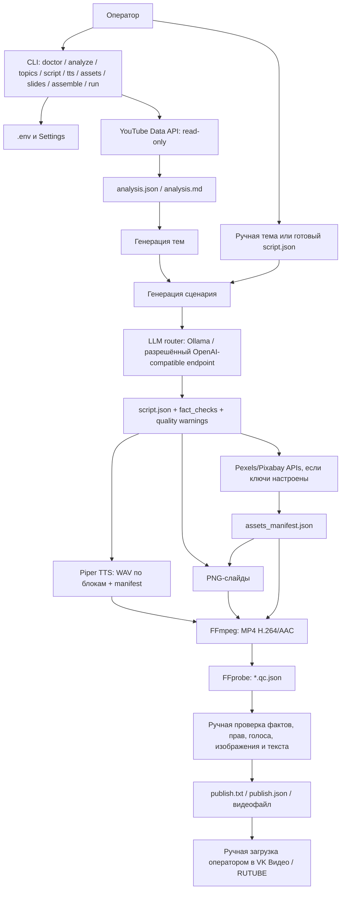

# AI Video Factory RU / video-farm — архитектура актуальной рабочей ветки

**Версия:** 1.5 — нормализация `voice_text` и канонизация кодов падежа  
**Дата:** 16.10.2026  
**Статус:** архитектура текущего CLI-проекта зафиксирована; MVP не следует считать полностью готовым к регулярному производству до выполнения критериев приёмки ниже.

## 1. Корректировка источника истины

В материалах проекта есть две разные сборки, которые нельзя смешивать:

1. `video-farm.zip` — CLI-проект на Python для Windows, в котором уже реализован TTS через Piper. Именно эта ветка соответствует проведённому пользователем тесту Piper и принимается здесь за текущую рабочую ветку.
2. `AI_Video_Factory_RU.zip` — отдельный прототип Streamlit с собственной структурой модулей и TTS через `pyttsx3`/Yandex SpeechKit. Его 32 теста и его код нельзя приписывать ветке `video-farm` без отдельного переноса и повторного тестирования.

Ранее решение Kokoro-ru v2 ошибочно перенесли в архитектурное описание текущей ветки из другого набора материалов. Kokoro остаётся отдельным benchmark-кандидатом и не является движком основного CLI. На 25.10.2026 Piper остаётся текущей технической интеграцией, но производственное решение по TTS открыто: Piper оценён в 2,5/5, Kokoro Dima — в 3,5/5, оба ниже внутреннего порога 4/5; права моделей/голосов также не закрыты. Пользователь подтвердил, что числа в ручном сценарии, записанные словами с правильными окончаниями, стали звучать правильно. В `video-farm` добавлен ограниченный нормализатор `voice_text` для конкретных числовых шаблонов; реальная работа с `num2words` и повторное аудио на Windows ещё требуют проверки. После ревизии исходного кода `num2words 0.5.14` нормализатор стандартизирован на коротких кодах падежей (`n/g/d/a/i/p`); библиотека также принимает английские aliases. Реальный пакет ещё не был запущен в этом контейнере. Единый статус требований ведётся в `docs/01_SRS.md`.

## 2. Цель и границы MVP

Локально производить оригинальные русскоязычные видео для последующей ручной публикации в VK Видео и RUTUBE. YouTube используется как источник исследования тем, а не как цель публикации текущего MVP.

### Входит

- CLI-команды для диагностики, исследования YouTube, генерации тем и сценария;
- основной и необязательный резервный LLM через OpenAI-compatible API, с локальным Ollama как вариантом по умолчанию;
- локальная озвучка Piper CPU;
- поиск/загрузка медиа через официальные API Pexels/Pixabay, если ключи настроены;
- манифест источников медиа для правовой проверки;
- PNG-слайды, монтаж MP4 через FFmpeg и технический QC через FFprobe;
- описание и пакет материалов для публикации;
- ручная проверка человеком до публикации.

### Не входит

- автоматическая загрузка/публикация в VK Видео или RUTUBE;
- создание каналов, автоматическое управление несколькими каналами и расписанием;
- получение/ответы на комментарии;
- включение монетизации и управление выплатами;
- собственные рекламные интеграции, промокоды, партнёрские ссылки, ERID/ОРД;
- обещание конкретного количества просмотров или дохода;
- автоматический юридический вывод о законности видео.

## 3. Архитектурные решения

| ID | Решение | Статус |
|---|---|---|
| ADR-01 | Local-first CLI на Python 3.12/3.13; сборка на Windows 10/11 | Принято |
| ADR-02 | YouTube — исследовательский источник; целевые площадки публикации — VK Видео и RUTUBE | Принято |
| ADR-03 | Текущая TTS-интеграция — Piper, голос по умолчанию `ru_RU-dmitri-medium`; локальный CPU | Интеграция есть; производственное принятие заблокировано: качество контрольного сценария не принято, права голоса не подтверждены |
| ADR-04 | Kokoro-ru v2 не входит в основной CLI; допускается как кандидат для замены TTS | Первый ONNX benchmark выполнен на Windows; пользовательская оценка 3,5/5. Открыто до повторной оценки после text normalization и закрытия вопроса OpenRAIL о распространении выходов |
| ADR-05 | Видеоряд в MVP состоит из графических слайдов и при наличии разрешённых файлов — коротких B-roll-вставок | Реализовано в коде; фактическое качество/права проверяет человек |
| ADR-06 | Формат текущего рендера — 1920×1080, 16:9, H.264/AAC; вертикальный 9:16 не считать реализованным до появления отдельной настройки и тестов | Горизонтальный рендер реализован; вертикальный формат — требование последующей доработки, если он остаётся обязательным |
| ADR-07 | Публикация только человеком вручную; в проекте нет загрузчика платформ | Принято |
| ADR-08 | LLM-провайдер переключаемый, но удалённый endpoint используется только после проверки доступности и оплаты из РФ, коммерческих условий, требований раскрытия ИИ и формата API | Принято как условие подключения; конкретный облачный провайдер ещё не утверждён |
| ADR-09 | Платные API необязательны для локального прогона готовой темы, но анализ трендов и поиск стоков зависят от API-ключей | Принято |
| ADR-10 | Секреты хранятся в `.env`, ключи не добавляются в git/архивы | Принято |
| ADR-11 | Доходы/монетизация не являются этапом текущего MVP | Принято |

## 4. Схема потока данных

## 5. Компоненты текущего кода

| Компонент | Файл | Назначение / границы |
|---|---|---|
| CLI и оркестрация | `src/video_farm/cli.py` | Команды и объединённый pipeline `run`; без графической панели |
| Подготовка произносимого текста | `src/video_farm/text_normalization.py` | Нормализует известные даты/время/проценты/единицы/валюты и часть моделей; оставшиеся цифры направляет на ручную проверку |
| Конфигурация | `src/video_farm/config.py`, `.env.example` | Пути, LLM, YouTube, stock API, Piper и параметры рендера |
| LLM | `src/video_farm/llm.py`, `content.py` | Генерация тем/сценариев через OpenAI-compatible API; совместимость конкретного endpoint нужно проверять |
| YouTube | `src/video_farm/youtube.py` | Официальный YouTube Data API; без HTML scraping и скачивания чужих видео |
| Piper | `src/video_farm/tts.py` | Shared `voice_text` normalization, скачивание модели/конфига при первом запуске, WAV и manifest с исходным/нормализованным текстом и числовыми предупреждениями |
| Медиа | `src/video_farm/assets.py` | Pexels/Pixabay API при наличии ключей; метаданные источника в manifest |
| Слайды | `src/video_farm/slides.py` | PNG-сцены; графики без проверенных данных нельзя выдавать за реальные измерения |
| Сборка | `src/video_farm/assemble.py` | FFmpeg, монтаж, описание публикации и QC-отчёт через FFprobe |
| Общие утилиты | `src/video_farm/common.py` | JSON, пути, валидация/нормализация вспомогательных данных |

## 6. Piper: зафиксированное решение

- TTS: Piper, вызываемый локально на CPU.
- Голос по умолчанию в текущем архиве: `ru_RU-dmitri-medium`.
- Модель и конфигурация сохраняются в `data/models/piper`; при первом запуске требуется интернет для загрузки, далее синтез возможен локально.
- Генерация текста/LLM отделена от TTS: выбор Piper не означает, что LLM также обязательно должна быть локальной.
- Никакой Kokoro-зависимости или окружения `.venv-kokoro-312` для этой ветки не добавлять.
- Ветка проекта и тесты не должны автоматически менять голос. Перед сменой голоса требуется повторная проверка конкретной лицензии и качества.
- Предыдущая формулировка о CC0/метке MIT не является подтверждением коммерческих прав. Карточки `dmitri` и `denis` указывают fine-tuning from U.S. English Lessac, а условия Lessac ограничивают коммерческое использование исходных материалов. См. `docs/06_piper_licensing_audit.md`. Техническая интеграция Piper остаётся, но производственное принятие TTS и коммерческий release gate по этим голосам заблокированы до письменного подтверждения/замены модели.
- PyPI указывает на `GPL-3.0-or-later` для `piper-tts`. Правила распространения программного пакета отделяются от прав на голосовую модель и от лицензирования сгенерированного аудио.

## 7. Безопасность, качество и ручные ворота

1. `.env` не коммитить; реальные ключи не помещать в отчёты, JSON и архивы.
2. API вызываются только по явной команде пользователя, с уважением к квотам/условиям провайдера.
3. Любые числа, характеристики моделей, цены, даты и другие проверяемые факты сверяются с первоисточниками.
4. Для стокового B-roll сохраняются URL/автор/источник и проверяется действующая лицензия каждого конкретного файла.
5. Отсутствие стоков должно отражаться как предупреждение; описания нельзя оставлять с ложной атрибуцией.
6. QC технически проверяет файл, но не доказывает фактическую достоверность, авторское право, достаточную оригинальность или соответствие монетизации.
7. Публикация — только после ручной проверки и одобрения; автоматические публикация и ответы комментариев отсутствуют.
8. Не использовать накрутку, искусственные комментарии, спам или копирование конкурирующих роликов.

## 8. Расхождения и работы до пилота

- Проверить полный пользовательский тест Piper, сохранить команду, версию Piper, точную версию/voice model, контрольный WAV и оценку произношения/времени. В рамках этой сессии подтверждено наличие интеграции в коде и пользователь сообщил о тесте; воспроизводимый протокол теста здесь не приложен.
- [БЛОКЕР ДЛЯ КОММЕРЧЕСКОГО ВЫПУСКА] Подтвердить права на модель и аудиовыход: модели `dmitri` и `denis` основаны на Lessac, чьи исходные материалы имеют research-only terms. Зафиксировать письменный ответ или выбрать альтернативный голос; детали в `docs/06_piper_licensing_audit.md`.
- Проверить GPL-обязательства для точной установленной версии `piper-tts`, особенно если сам `video-farm` будет передаваться клиентам.
- Запустить полный pipeline на целевом Windows-компьютере с реальной русской речью и проверить итог на слух.
- В текущем архиве горизонтальный 16:9 реализован; если требование двух форматов остаётся обязательным, добавить вертикальный 9:16 как отдельный renderer profile и тесты, не считать это уже реализованным.
- Добавить/проверить блокирующий учёт бюджета до внешних вызовов. В этой CLI-сборке нельзя считать установленные в другом Streamlit-прототипе SQLite budget caps реализованными без переноса соответствующего кода.
- Утвердить конкретный LLM endpoint только после проверки рублёвой оплаты/доступа из РФ и коммерческих/договорных условий. По умолчанию локальный Ollama исключает оплату API, но качество и скорость требуют измерения на целевом устройстве.
- Выполнить end-to-end тест: готовый сценарий → автоматический `voice_text` normalization → WAV → assets manifest → PNG → MP4 → QC → ручная проверка → publish package.
- Обновление 16.10.2026: для TTS добавлен контрольный script и расширяемый manifest с версиями/хешами; валидируются параметры каждого WAV, а монтаж прерывается при неполном аудиоманифесте. Автоматические тесты после обновления нормализатора: 30 passed, 1 skipped (пропуск — интеграционный тест реального `num2words`, который отсутствует в контейнере). Проведён только синтетический smoke-test видео; реальный Piper и Windows-окружение пока не проверены в этой сессии. QC также передаёт сведения об использованных стоках в пакет публикации; неиспользованные Pexels/Pixabay не указываются как источники.

## 9. Критерии готовности MVP

Подробные требования, история проверок и актуальный реестр открытых вопросов сведены в `docs/01_SRS.md` (актуальность 25.10.2026).

- [ ] `doctor` проходит на целевой Windows-системе.
- [ ] Piper генерирует валидные WAV для каждого блока сценария; manifest соответствует созданным файлам.
- [ ] Вручную прослушан итоговый русский голос после автоматической нормализации: имена, числа, даты, аббревиатуры, паузы; оставшиеся цифры из предупреждений вручную исправлены.
- [ ] Сценарий содержит список проверяемых утверждений/источников; все значимые утверждения проверены человеком.
- [ ] `assets_manifest.json` отражает реальные скачанные материалы; лицензии проверены.
- [ ] FFmpeg собирает MP4, а FFprobe подтверждает заданные характеристики; ролик также проверен визуально и на слух.
- [ ] Описание не утверждает, что использованы медиа, которых нет в итоговом видео.
- [ ] Внешние вызовы и возможные повторные попытки ограничиваются явным бюджетом; фактические списания сверены с провайдерами.
- [ ] Проверено восстановление файлов/выходных артефактов из резервной копии.
- [ ] Ни одна команда не публикует ролик автоматически.
- [ ] Первый пилот подготовлен в пределах бюджета и вручную одобрен владельцем.

### Дополнение 25.10.2026 — num2words case-code compatibility

Русская локаль `num2words 0.5.14` поддерживает короткие коды падежей `n/g/d/a/i/p` и английские aliases. Нормализатор стандартизирован на коротких кодах, моки обновлены, добавлен интеграционный тест реального пакета. В контейнере тест пропущен, так как пакет не удалось загрузить из PyPI. Обязательная проверка остаётся на Windows после установки extra `[tts,test]`.

## Актуализация 26.10.2026 — нормализатор v0.2.2

`num2words 0.5.14` был запущен на Windows с версией нормализатора v0.2.1. Анализ выявил недостающие формы числительных для женских единиц и глобальную замену тире запятой. В v0.2.2 внесены ограниченные исправления и регрессионные тесты; контейнерный прогон: 33 passed, 1 skipped. Исправление ещё нужно выполнить в Windows с реальным `num2words` и подтвердить по нормализованному тексту и WAV.
